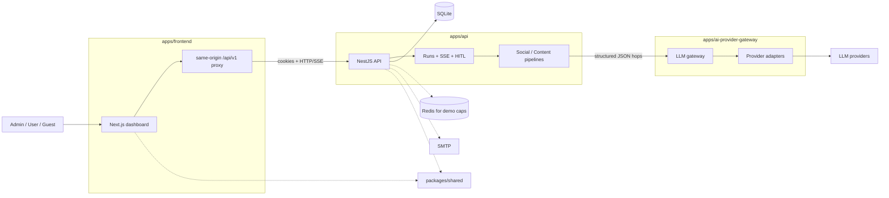
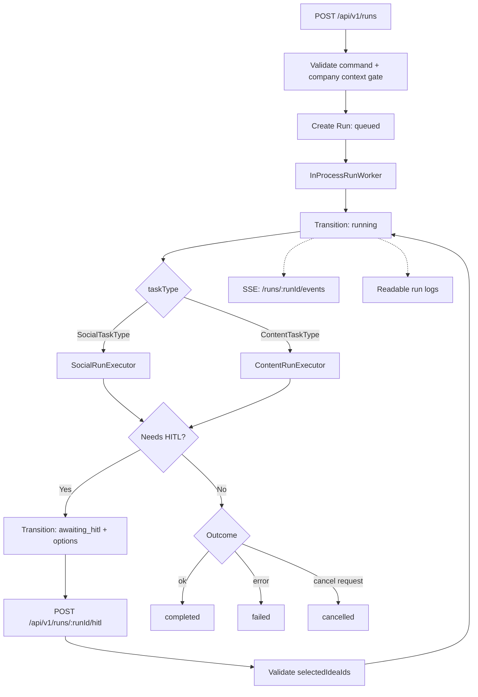
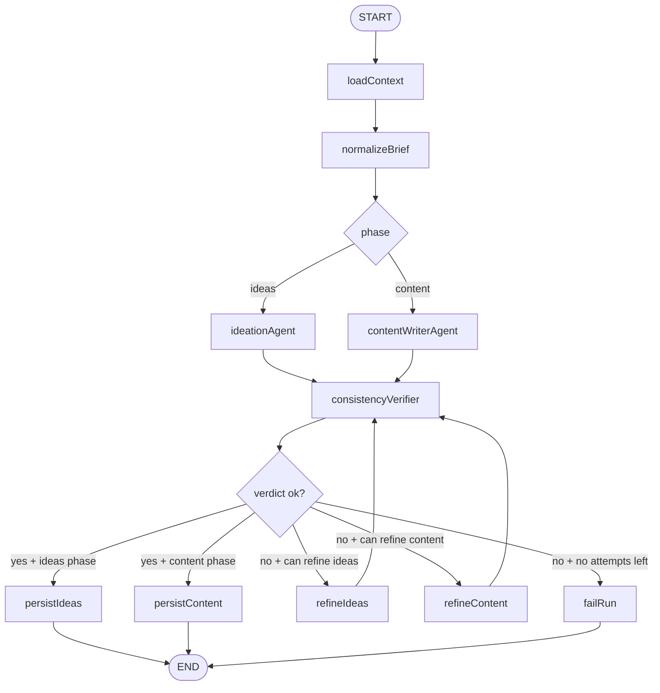
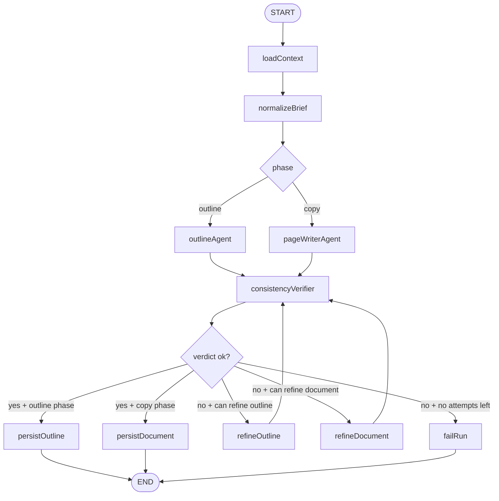

# Content Chain

   
   

**Content Chain** is a self-hosted AI content generation dashboard powered by agent pipelines, a shared company context, and a dedicated LLM gateway.

> 🚧 **Work in progress:** Content Chain is under active development. APIs, UI, deployment details, and product behavior may change. Do not treat this repository as production-ready yet.

## Table Of Contents

- [Overview](#overview)
- [Key Features](#key-features)
- [Architecture](#architecture)
- [Agent Run Flows](#agent-run-flows)
- [Monorepo Structure](#monorepo-structure)
- [Tech Stack](#tech-stack)
- [Requirements](#requirements)
- [Quick Start](#quick-start)
- [Environment Configuration](#environment-configuration)
- [Running With Docker Compose](#running-with-docker-compose)
- [Usage Flow](#usage-flow)
- [API And Documentation](#api-and-documentation)
- [Testing And Quality](#testing-and-quality)
- [Observability](#observability)
- [Security Notes](#security-notes)
- [Project Status](#project-status)
- [License](#license)

## Overview

Content Chain is a public, MIT-oriented, self-hosted application for generating marketing and web copy from one shared company context. A user submits a brief, the backend runs an agent pipeline, the output is checked against the company profile, and the whole run is stored with readable logs.

The product focuses on two generation channels:

- **Social**: post ideas, post content, and short-form reel scripts for LinkedIn, Facebook, and Instagram.
- **Content**: basic page and article copy, including blog posts, service pages, and landing pages.

One installation is designed for one company and one shared context. It is not a multi-tenant SaaS product.

## Key Features

- 🤖 **Agent-based content pipelines** for Social and Content generation flows.
- 🧭 **Shared company context** used as the canonical source for tone, offer, CTA, and audience rules.
- ✅ **Context completeness gate** that blocks runs until the required company context is ready.
- 📡 **Async runs with live updates** through Server-Sent Events.
- 🧑‍💻 **Human-in-the-loop steps** for two-stage flows such as idea selection or outline approval.
- 📚 **Readable run logs** persisted in the database and visible in the dashboard.
- 🔐 **Authentication and first-run bootstrap** for self-hosted installations.
- 🧪 **Guest/demo mode support** with Redis-backed daily caps when enabled.
- 🚪 **Dedicated LLM gateway** so the product API never talks directly to model vendors.
- 🐳 **Compose-first self-host deployment** with frontend, API, and gateway services.

## Architecture

The repository is a TypeScript monorepo with three runtime applications and one shared package.

| Application | Role |
| --- | --- |
| `apps/frontend` | Next.js dashboard for company context, generation flows, run logs, review, and account interactions. It is a thin UI client with no domain rules and no direct LLM vendor access. |
| `apps/api` | NestJS product backend. It owns authentication, company context, Social and Content pipelines, async runs, logs, feedback, and persistence. |
| `apps/ai-provider-gateway` | Standalone NestJS LLM gateway. It routes requests to model providers and has no Content Chain product logic. |
| `packages/shared` | Lightweight shared contracts and public API-facing types. |



The global shape is a modular monolith: clear process boundaries, a single repository, and explicit ownership of domain logic inside `apps/api`.

## Agent Run Flows

Content Chain uses LLMs through controlled agent runs, not through direct free-form calls from the UI. The `runs` module owns the lifecycle, status transitions, logs, SSE, HITL resume, cancellation, and review commands. The `social` and `content` modules own the channel-specific LangGraph pipelines. All model calls go through `LlmHopService` and then through `apps/ai-provider-gateway`.

### Available Run Types

| Run type | Channel | Mode | Result |
| --- | --- | --- | --- |
| `post_ideas` | Social | Full-auto | Post ideas |
| `post_content` | Social | Full-auto | Single post content |
| `post_ideas_then_content` | Social | HITL | Ideas, then content for selected ideas |
| `reel_ideas` | Social | Full-auto | Short-form reel ideas |
| `reel_script` | Social | Full-auto | Single reel script |
| `reel_ideas_then_scripts` | Social | HITL | Reel ideas, then scripts for selected ideas |
| `page_copy` | Content | Full-auto | Page document |
| `page_outline_then_copy` | Content | HITL | Page outline, then page document |

### Run Lifecycle

Every run starts in `apps/api/src/runs`. The API validates the command, checks company context completeness, creates a queued run, and lets the in-process worker dispatch it to the Social or Content executor.



### Social Agent Graph

The Social graph supports post and reel flows. It first loads the company context and normalizes the brief, then routes to either an ideas phase or a content/script phase. Generated output is checked by a consistency verifier. If the verifier rejects the result and refinement is still allowed, the graph loops through a refinement node before verifying again.



For `post_ideas_then_content` and `reel_ideas_then_scripts`, the run pauses after the ideas phase. The user selects one or more generated IDs, and the resumed run creates one content artifact or script per selected idea.

### Content Agent Graph

The Content graph supports full-auto page copy and outline-to-copy HITL flows. It uses the same high-level pattern as Social: context loading, brief normalization, an agent phase, consistency verification, optional refinement, and persistence.



For `page_outline_then_copy`, the run pauses after the outline phase. HITL resume must select exactly the generated outline ID before the run can continue into the copy phase.

### How LLMs Are Used

LLM usage is centralized in `LlmHopService`. Each agent node requests structured JSON from the gateway using the configured `GATEWAY_MODEL_ALIAS`. The response is parsed against a Zod schema, and invalid structured output triggers a repair retry. A hop can retry up to three times for retryable gateway or structured-output failures.

Each successful or failed hop appends a readable run log entry. Cancellation is propagated with `AbortSignal`, so a cancelled run can stop in-flight LLM work from the API side. Provider-specific details remain inside `apps/ai-provider-gateway`; product code works with a gateway port and model alias instead of vendor SDKs directly.

### HITL Rules

- `post_ideas_then_content`: the user selects a non-empty unique subset of generated post idea IDs.
- `reel_ideas_then_scripts`: the user selects a non-empty unique subset of generated reel idea IDs.
- `page_outline_then_copy`: the user selects exactly the generated outline ID.
- `ResumeHitlUseCase` validates the selection before the run transitions back to `running`.

## Monorepo Structure

```text
.
├── apps/
│   ├── api/                  # Product backend: auth, runs, pipelines, persistence
│   ├── frontend/             # Next.js dashboard and BFF-style proxy
│   └── ai-provider-gateway/  # LLM provider gateway and gateway CLI
├── packages/
│   └── shared/               # Shared public contracts/types
├── docs/                     # Product, architecture, deployment, UX, security docs
├── spec/                     # Enforceable project specifications
├── feature-plans/            # Implementation plans and completed slices
├── docker-compose.yml        # Compose-first production stack
├── Jenkinsfile               # Production-oriented Jenkins deployment pipeline
└── Jenkinsfile.lab           # Lab/staging-oriented Jenkins pipeline
```

## Tech Stack

| Area | Tools |
| --- | --- |
| Language and workspace | TypeScript, pnpm workspaces |
| Frontend | Next.js 16, React 19, Tailwind CSS, shadcn/Radix-style UI primitives |
| Backend | NestJS 11, Prisma, SQLite, JWT cookies, Swagger/OpenAPI |
| Agent orchestration | LangChain, LangGraph |
| Gateway | NestJS, OpenAI/Anthropic/Google provider clients, gateway CLI |
| Validation | Zod, class-validator |
| Observability | Pino, Prometheus metrics, domain run logs, SSE |
| Deployment | Docker Compose, Jenkins, Vault-backed secret injection |

## Requirements

For local development:

- Node.js compatible with the project toolchain.
- `pnpm` 9.
- SQLite through Prisma for the API.
- LLM provider credentials and gateway configuration.

For production-like self-hosting:

- Docker and Docker Compose.
- A root `.env` file with all runtime secrets.
- An existing external `main_network` Docker network for the host edge/reverse proxy setup.
- Redis when `DEMO_MODE=true` and guest daily caps are enabled.
- SMTP credentials in `production` for invitations and account activation.

## Quick Start

Install dependencies from the repository root:

```bash
pnpm install
```

Create local environment files:

```bash
cp apps/api/.env.example apps/api/.env
cp apps/frontend/.env.example apps/frontend/.env
```

Configure the AI provider gateway according to your provider setup, then run the three development processes:

```bash
pnpm dev:gateway
pnpm dev:api
pnpm dev:frontend
```

Open the frontend on port `3004` and complete the first-run admin bootstrap when the UI reports that bootstrap is available.

## Environment Configuration

Development uses per-app `.env` files. Production uses one root `.env` file consumed by Docker Compose and generated by the deployment pipeline.

Important API variables include:

- `DATABASE_URL`
- `GATEWAY_BASE_URL`
- `GATEWAY_KEY`
- `GATEWAY_MODEL_ALIAS`
- `JWT_SECRET`
- `JWT_ACCESS_TTL`
- `JWT_REFRESH_TTL`
- `CORS_ORIGIN`
- `MAX_CONCURRENT_RUNS`
- `DEMO_MODE`
- `GUEST_GLOBAL_CAP_PER_DAY`
- `GUEST_RATING_CAP_PER_DAY`
- `REDIS_HOST`, `REDIS_PORT`, `REDIS_PASSWORD`
- `SMTP_HOST`, `SMTP_PORT`, `SMTP_USER`, `SMTP_PASS`
- `MAIL_FROM`
- `APP_PUBLIC_URL`

Important frontend variable:

- `API_BASE_URL`

Never commit `.env` files, LLM provider keys, JWT secrets, SMTP credentials, gateway keys, or Vault-derived values.

## Running With Docker Compose

The production-oriented stack is Compose-first:

```bash
docker compose up -d --build
```

The root `docker-compose.yml` starts three runtime services:

| Service | Container | Host Bind | Role |
| --- | --- | --- | --- |
| `ai-provider-gateway` | `cc-ai-gateway` | `127.0.0.1:3100` | LLM gateway |
| `api` | `cc-api` | `127.0.0.1:3001` | Product backend, domain logic, runs, persistence |
| `frontend` | `cc-frontend` | `0.0.0.0:3004` | Web dashboard |

SQLite is stored in the named `api-sqlite` volume and mounted into the API container at `/app/data`.

The stack uses two networks:

- `cc-network` for internal service DNS.
- `main_network` as an external network for host-level routing or reverse proxy integration.

## Usage Flow

1. Start the stack locally or with Docker Compose.
2. Bootstrap the first admin account.
3. Fill the required company context sections.
4. Start a Social or Content generation run.
5. Watch live progress and readable logs in the dashboard.
6. Complete the HITL step when the selected flow requires it.
7. Review the result, optionally edit it, rate it, and finalize the review.

## API And Documentation

The product API is exposed under `/api/v1`.

Useful endpoints and surfaces:

- API health: `GET /api/v1/health`
- API readiness: `GET /api/v1/health/ready`
- Gateway readiness: `GET /api/v1/health/ready` on the gateway service
- Swagger UI: `/docs` on the API service
- API Postman notes: `apps/api/test/postman/README.md`
- Product and architecture docs: `docs/`
- Enforceable implementation specs: `spec/`

## Testing And Quality

The repository uses Jest-based tests for backend and gateway code, e2e coverage for the API, ESLint for static checks, and Prettier for formatting.

Useful quality commands:

```bash
pnpm lint
pnpm format:check
pnpm test:api
pnpm test:e2e:api
```

The gateway also includes additional test and type coverage scripts inside `apps/ai-provider-gateway`.

## Observability

Content Chain separates product-level observability from process-level observability:

- **Run logs** are domain records stored in the database and streamed to the UI through SSE.
- **Process logs** go to stdout/stderr through the runtime logger.
- **Metrics** are exposed by the API through `/metrics`.
- **Gateway metrics** can be scraped separately when configured.
- **Health checks** are wired into Docker Compose for the gateway and API.

## Security Notes

- The frontend should use same-origin `/api/v1` access through the Next.js server-side proxy model.
- Auth uses httpOnly cookies for access and refresh tokens.
- The browser should not talk directly to `apps/api` in production deployments.
- The browser and product API should never call LLM vendors directly; all model access goes through `apps/ai-provider-gateway`.
- `GATEWAY_KEY`, JWT secrets, provider keys, SMTP credentials, Redis passwords, and Vault-derived values must stay out of git.
- `CORS_ORIGIN` must not be `*` in production.
- The gateway should not be exposed as a public origin.

## Project Status

Content Chain is not finished yet. It is suitable for development, architecture review, and iterative self-host MVP work, but not for unattended production usage.

Expect changes in:

- API contracts.
- UI flows.
- Deployment details.
- Environment variables.
- Data model and migrations.

## License

Content Chain is documented as an MIT-oriented public self-host project. Before external distribution, make sure the root repository contains the final `LICENSE` file matching that intent.
